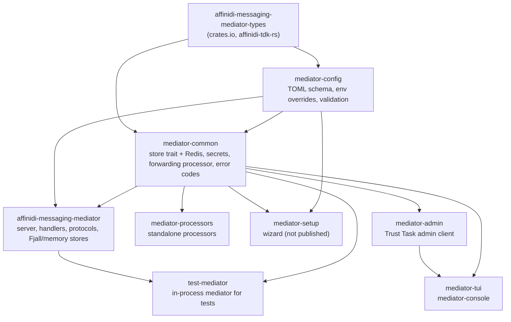
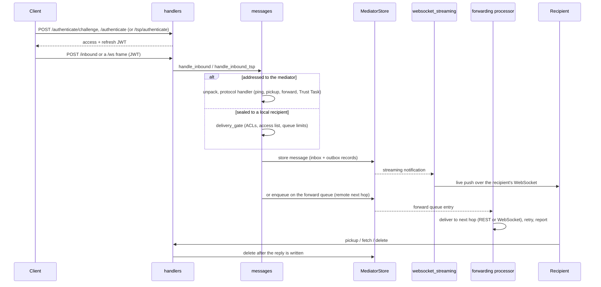

# Architecture

A map for contributors: which crate does what, where each part of the
mediator lives, and the path a message takes from the request that brings it
in to the delete that removes it. Operators want
[operations.md](operations.md) instead.

## Workspace crates

All crates are versioned together (see [RELEASES.md](../../../RELEASES.md)).

`mediator-admin` and `mediator-tui` use `test-mediator` only as a dev
dependency. The client side (the ATM SDK, DIDComm, TSP, DID resolution, the
Trust Tasks framework) comes from affinidi-tdk-rs and the Trust Tasks crates
on crates.io.

| Crate | Holds |
|---|---|
| `affinidi-messaging-mediator-config` | `ConfigRaw`, the raw `mediator.toml` schema; reading the file and applying `Env:` overrides; the startup validation the wizard reuses. |
| `affinidi-messaging-mediator-common` | The `MediatorStore` trait family (`store/traits/`) and the Redis implementation with its Lua functions (`store/redis/`); secret backends and the secrets bundle (`secrets/`); the forwarding processor (`tasks/forwarding/`); the storage circuit breaker; the error code registry (`error_codes.rs`, the source of `ERRORS.md`). |
| `affinidi-messaging-mediator` | Everything that serves requests, below. |
| `affinidi-messaging-mediator-processors` | `forwarding_processor` and `message_expiry_cleanup` binaries for running those jobs outside the mediator process (Redis only). The mediator also runs both itself. |
| `mediator-setup` | The setup wizard (TUI and headless recipes). Writes `mediator.toml` from the template in `conf/` and provisions keys into the secret backend. |
| `affinidi-messaging-test-mediator` | `TestMediator`: a real mediator on an ephemeral port with an in-memory store, for other projects' integration tests. |
| `affinidi-messaging-mediator-admin` | Headless administration over Trust Tasks. |
| `affinidi-messaging-mediator-tui` | The `mediator-console` terminal UI, built on the admin client. |

## The mediator crate

`main.rs` parses the CLI and calls `server::start`, or a subcommand in
`commands/`. Everything else is the library, which embedders reach through
`builder::MediatorBuilder`.

| Module | Role |
|---|---|
| `builder` | `MediatorBuilder`, `StartOpts`, `MediatorHandle`: start a mediator from code, with no TOML, no working-directory assumptions, and no global subscriber or signal handlers unless asked. |
| `server` | Startup. `start` reads the config file and installs tracing, then `serve_internal` (shared with the builder) runs the phases: build the store, install metrics, seed the privileged accounts, apply stored limit overrides, spawn background tasks, build the DID resolver, spawn forwarding, assemble `SharedData`, start DID multiplexing, start the wake re-arm loop (when `[processors.wake]` is enabled; it re-evaluates armed wake requests every few seconds and holds nothing durable), build the router, bind and serve. Also the probe routes, the rate-limit layers and shutdown. |
| `commands` | `healthcheck` and `rotate-admin`. |
| `common` | Cross-cutting pieces: `config` (the resolved `Config`, limits, live overrides), `jwt_auth` and `session` (the `Session` extractor), `authz` and `roles` (every permission decision), rate limiters, `metrics` and `request_metrics`, `request_id`, `http_server` (connection cap, header deadline), `storage_timeout`, `ws_budget`. |
| `handlers` | The axum handlers, one module per route (`application_routes` in `handlers/mod.rs` is the route table). `authenticate/` holds the challenge, DIDComm response, refresh and TSP login. `websocket/` is split by concern: `connection` (the per-socket state machine), `slot` (the connection's share of mediator-wide state, released on every exit), `liveness` (write deadlines, pings), `close` (close codes), `relay` (anonymous inter-mediator sockets), `reports` (in-band problem reports), `tsp_drain` (raw-TSP inbox delivery). `readiness` is `/readyz`. |
| `messages` | What happens to a message once a handler has it. `inbound/` is the entry point by protocol (`didcomm`, `tsp`, `tsp_relay`); `protocols/` holds the DIDComm protocol handlers and the Trust Task core; `delivery_gate` is the one local-delivery decision; `queue_limits` the depth gates; `store` the write paths; `client_delete` a client's delete. `inbound_v1` and `v1_mediation` are DIDComm v1 (feature `didcomm-v1`). |
| `store` | The Fjall and in-memory `MediatorStore` implementations (Redis lives in `mediator-common`). |
| `tasks` | Background work: `supervisor` (restart with backoff, health for `/readyz`), `websocket_streaming` (live delivery), `statistics`, `queue_survey`, `vta_refresh`, `system_packer` (how the forwarding processor gets mediator-authored messages packed). |
| `wake` | `messaging/wake/set` and `messaging/wake/request`: an account's push-gateway wake handle, the rules for ringing it (fresh, undelivered mail the requester queued), rate limits and coalescing, armed requests and the `push/wake` ring itself. |
| `mux` | DID multiplexing: grants and their proofs, the live registry, per-connection member sets, fair queuing, durable notices, cross-instance sync, audit records and the admin tasks. See [multiplexing.md](multiplexing.md). |
| `monitor` | The live traffic monitor behind the `messaging/monitor/*` Trust Tasks, and `fanout` for membership events across instances. |
| `after_write` | Work that may only run once a reply has reached its transport: delivered marks, monitor `delivered` events and deletes. |
| `activity`, `account_stats` | Per-account last-active times and message counters. |
| `didcomm_compat`, `tsp_identity`, `didcomm_v1_identity` | Adapters over the DIDComm crate, and the mediator's own TSP and v1 identities. |
| `scid_sources` | did:scid version floors persisted across restarts. |
| `task_specs` | Generated by `build.rs` from `trust-tasks.lock` and the bundles in `trust-tasks/`: the Trust Task types and versions this mediator serves. |

`SharedData` (in `lib.rs`) is the axum state every handler receives: the
config and live limits, the store, the DID resolver, the streaming task
handle, the mux registry, the monitor, rate limiters, the shutdown token and
the component health registry.

## Message lifecycle

### 1. Authentication

A client asks for a challenge (`POST /authenticate/challenge`), then answers
it: a DIDComm authcrypt message to `POST /authenticate`, or for TSP a signed
statement to `POST /tsp/authenticate`. Both mint the same session: a JWT
access token and a refresh token (`POST /authenticate/refresh`). Code:
`handlers/authenticate/`. Every authenticated route takes a `Session`
extracted by `common/jwt_auth.rs`; `/ws` takes the token from the
`Authorization` header or a `bearer.<jwt>` WebSocket subprotocol entry.

### 2. Ingress

`POST /inbound` (`handlers/message_inbound.rs`) and WebSocket frames
(`handlers/websocket/connection.rs`) both call into `messages::inbound`. The
body is sniffed: TSP goes to `inbound::tsp`, everything else to
`inbound::didcomm`. The message size is checked first.

For DIDComm, the routing headers are read without decrypting
(`didcomm_compat::MetaEnvelope`):

- **Addressed to the mediator.** The message is unpacked, its sender checked
  against the session (`messages::authenticated_sender`), and `MessageType`
  in `messages/mod.rs` dispatches it: trust ping, Message Pickup, `forward`
  (`protocols/routing.rs`), discover features, or a Trust Task envelope.
- **Sealed to a local recipient** (direct delivery). The mediator cannot open
  it; it stores it after the delivery gate.

TSP is similar: a message for a local VID is stored opaque, a routed layer
addressed to the mediator is relayed (`inbound/tsp_relay.rs`), and a
`Direct` or `Control` message to the mediator may carry a Trust Task.

### 3. Delivery decision

Every path that stores a message it did not author for a local account goes
through `messages::delivery_gate`: is the recipient an account here, may it
receive, does its access list accept this sender, does it accept anonymous
or forwarded mail. Every refusal is the same `e.p.delivery.refused`, so a
sender cannot probe which DIDs exist; the reason is logged. Then
`messages::queue_limits` applies the per-peer, per-sender and per-recipient
depth limits.

A `forward` whose next hop is not local is placed on the forwarding queue
instead (`routing.rs`), after loop and hop-count checks.

### 4. Storage

`messages::store` writes through the `MediatorStore` trait: one record per
recipient in the recipient's inbox, and one in the sender's outbox. The
backend is Redis (`mediator-common/src/store/redis/`, with Lua functions in
`conf/atm-functions.lua`), Fjall or memory (`src/store/`). A reply the
mediator authors is packed and stored the same way. Messages carry an expiry;
the `message_expiry_sweep` task removes expired ones.

### 5. Live delivery

After the write, the store publishes a streaming notification (Redis pub/sub
across processes; an in-process broadcast for Fjall and memory). The
`websocket_streaming` task holds one channel per registered DID and pushes
the message onto the recipient's socket when live delivery is on. Each
instance owns the entries for the sockets it holds, with a heartbeat, so a
cluster delivers to whichever instance has the socket and takes over the
entries of a dead one. A push that cannot be queued is not lost: the message
is in the inbox and the client is sent a pickup `status` to collect it.

On a DID multiplexing connection, one socket carries many DIDs; `mux/`
decides which members may receive which frames and queues them fairly.

### 6. Forwarding

The forwarding processor (`mediator-common/src/tasks/forwarding/processor.rs`)
consumes the forward queue, resolves the next hop's endpoint, and delivers
over REST, or over a WebSocket once traffic to that endpoint is above
`ws_threshold`. Failures retry with backoff; a refused or abandoned forward
can be reported to the sender. Mediator-authored messages it needs are
packed by the host through `tasks/system_packer.rs`. The relay modes (blind
or rewrap) are described in [multi-mediator.md](multi-mediator.md).

### 7. Pickup, acknowledgement and delete

A client collects mail with Message Pickup (`protocols/message_pickup.rs`:
status, delivery request, messages received, live delivery change), with
`POST /fetch` or `POST /outbound`, or by live delivery. It releases a message
with `messages-received`, `DELETE /delete`, or `/outbound` with delete.
`messages::client_delete` makes sure a delete removes only the caller's own
record of a message stored for several recipients.

Delivered marks, `delivered` monitor events and deletes that follow a reply
are never done inside the handler. The handler hands them to `after_write`,
and the transport runs them once the reply is actually written: when a REST
body has been fully handed to the connection, or when a live push is
accepted. A reply that never reaches the client deletes nothing.

## Trust Tasks

Trust Tasks are the management surface: accounts, ACLs and access lists, mux
grants, statistics, queues, messages, the monitor, audit and runtime config.

- **DIDComm**: a message of the Trust Task envelope type reaches
  `protocols/trust_tasks/mod.rs` (`process`).
- **TSP**: `inbound/tsp.rs` (`dispatch_tsp_trust_task`) unpacks it and calls
  the same core.

Both call `trust_tasks::consume`, which runs the acceptance checks
(`trust_task_verify.rs`: freshness, sender identity, proofs, replay), routes
by task type over the served set generated in `task_specs`, and runs the
handler. Handlers live in `trust_tasks/{accounts,access_lists,admin,mux}.rs`
and `mediator_ops.rs` (stats, queue, message, monitor, config). Responses
are signed (`trust_task_sign.rs`); refusals are `trust-task-error` documents
(`trust_task_error.rs`). Authorization goes through `common::authz` and
`common::roles`. Adding a served task means pinning it in `trust-tasks.toml`
/ `trust-tasks.lock`, adding its bundle under `trust-tasks/`, and handling the
new `ServedTask` variant.

## Where to look for

| You want | Start at |
|---|---|
| A route | `handlers/mod.rs`, `application_routes`; probes and `/metrics` in `server.rs`. |
| Startup order | `server::serve_internal`. |
| A permission decision | `common/authz.rs`, `common/roles.rs`. |
| A storage operation | `mediator-common/src/store/traits/`, then the backend. |
| An error code | `mediator-common/src/error_codes.rs` and `ERRORS.md`. |
| A config key | `mediator-config` (raw schema) and `common/config/` (resolved). |
| A metric | `common/metrics.rs`, `names`. |
